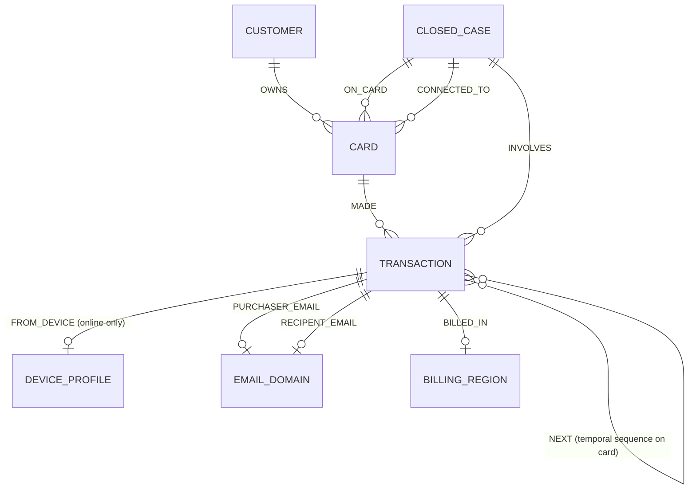

# FraudGraph AI — Dataset Availability & Validation Report

> **Status:** FINAL DATASET VALIDATION COMPLETE
> **Data Source:** HHGOA_IEEE Dataset (TigerGraph × Hacker House Goa 2026 Edition)
> **Location:** `dataset/HHGOA_IEEE/`
> **Date:** 2026-09-21

---

## 1. Dataset Verification & File Inventory

The dataset is fully available directly in the workspace directory `dataset/HHGOA_IEEE/`.

| File | Exact File Size | Total Row Count | Total Column Count | Primary Key / Join Key | Purpose |
|---|---|---|---|---|---|
| `README.md` | ~38.6 KB | 473 lines | N/A | N/A | Official task specification, policy, rules, answer format & case pack |
| `transactions.csv` | ~708 MB | 590,742 | 397 | `TransactionID` (PK) | Full 6-month transaction dataset (July 2 – Dec 31, 2016) |
| `identity.csv` | ~30.5 MB | 144,432 | 41 | `TransactionID` (FK) | Device & network identity records for online transactions |
| `closed_cases_history.csv` | ~1.2 MB | 5,565 | 15 | `case_id` (PK) | Finished investigations (July–Oct 2016): 4,665 fraud / 900 cleared |
| `case_pack.csv` | ~3.8 KB | 20 | 8 | `case_id` (PK) | The 20 exam benchmark alerts (Nov–Dec 2016) |

---

## 2. Column Profiles & Schemas

### 2.1 `transactions.csv` (397 Columns)

- **Original Vesta Columns (393):**
  - `TransactionID` (int): Unique transaction identifier.
  - `TransactionDT` (int): Timedelta in seconds from start.
  - `TransactionAmt` (float): Transaction amount in USD.
  - `ProductCD` (string): `W` (in-person, no identity row), `C`, `H`, `R`, `S` (online).
  - `card1` to `card6` (mixed): Card attributes (`card4` network, `card6` type credit/debit).
  - `addr1` (float): Billing region code.
  - `addr2` (float): Billing country code (87 = home country).
  - `dist1`, `dist2` (float): Distance measures.
  - `P_emaildomain`, `R_emaildomain` (string): Purchaser and recipient email domains.
  - `C1` to `C14` (float): Counting features.
  - `D1` to `D15` (float): Timedelta features in days.
  - `M1` to `M9` (string): Match flags (`T`, `F`, null).
  - `V1` to `V339` (float): Vesta engineered features.
- **Added Columns (4):**
  - `customer_id` (string): e.g. `C01234`. Derived from card issuer field.
  - `ts` (timestamp string): Real timestamp `YYYY-MM-DD HH:MM:SS` (July 2 – Dec 31, 2016).
  - `channel` (string): `in_person` (ProductCD `W`) or `online` (ProductCD `C`, `H`, `R`, `S`).
  - `risk_score` (float 0.0 – 1.0): Bank model risk score. **Input feature, not ground truth label.**

### 2.2 `identity.csv` (41 Columns)

- `TransactionID` (int): Foreign key matching `transactions.csv`.
- `id_01` to `id_11` (float): Numeric identity ratings (device/IP rating, proxy rating, etc.).
- `id_12` to `id_38` (string/float): Categorical identity fields:
  - `id_15`: Device status (`New` / `Found`).
  - `id_23`: Proxy type (`transparent`, `anonymous`, `hidden`).
  - `id_30`: Operating System (e.g. `Android 7.0`, `iOS 11.0`, `Windows`).
  - `id_31`: Browser (e.g. `chrome 62.0`, `safari`, `samsung browser 6.2`).
  - `id_33`: Screen resolution (e.g. `2220x1080`, `1920x1080`).
  - `id_34`: Match status string.
- `DeviceType` (string): `mobile` or `desktop`.
- `DeviceInfo` (string): Detailed device/platform description.

### 2.3 `closed_cases_history.csv` (15 Columns)

- `case_id` (string): e.g. `CC-0001` to `CC-5565`.
- `customer_id` (string): e.g. `C01234`.
- `card_id` (string): e.g. `C01234-K1`.
- `opened_at` (string): Timestamp `YYYY-MM-DD HH:MM:SS`.
- `closed_at` (string): Timestamp `YYYY-MM-DD HH:MM:SS`.
- `outcome` (string): `confirmed_fraud` (4,665 cases) or `cleared` (900 cases).
- `pattern` (string): `card_testing`, `card_not_present_fraud`, `card_not_present_new_device`, `out_of_region_use`, `account_takeover`, `undocumented`, `none`.
- `first_fraud_txn_id` (string): Starting transaction ID.
- `txn_ids` (string): Pipe-separated list of transaction IDs (e.g. `3412001|3412002`).
- `n_txns` (int): Number of transactions in case.
- `exposure_usd` (float): Total dollars involved.
- `connected_card_ids` (string): Pipe-separated list of connected cards.
- `actions_taken` (string): Recorded actions e.g. `BLOCK_CARD, CREATE_CASE`.
- `report_filed` (boolean): `TRUE` or `FALSE`.
- `analyst_notes` (string): Textual notes explaining investigation finding.

### 2.4 `case_pack.csv` (8 Columns)

- `case_id` (string): `HHG-001` through `HHG-020`.
- `opened_at` (string): Timestamp.
- `trigger_type` (string): `risk_score`, `customer_report`, or `analyst_request`.
- `trigger_text` (string): Narrative explanation of why the alert fired.
- `flagged_txn_id` (int): Transaction ID where alert fired.
- `card_id` (string): Target card ID (e.g., `C12382-K1`).
- `customer_id` (string): Target customer ID (e.g., `C12382`).
- `risk_score` (float/null): Model risk score (filled for `risk_score` triggers).

---

## 3. Entity & Relationship Map



### Key Graph Entities & Identifiers

1. **`Customer`**: Primary ID `customer_id` (e.g. `C01234`).
2. **`Card`**: Primary ID `card_id` (e.g. `C01234-K1`, `C01234-K2`).
3. **`Transaction`**: Primary ID `TransactionID` (int/string e.g. `3514030`).
4. **`DeviceProfile`**: Primary ID derived string `DeviceInfo` + `id_30` + `id_31` + `id_33` (e.g. `SAMSUNG SM-G935F | Android 7.0 | chrome 62.0 | 2220x1080`).
5. **`EmailDomain`**: Primary ID `P_emaildomain` / `R_emaildomain` (e.g. `gmail.com`).
6. **`BillingRegion`**: Primary ID `addr1` code (e.g. `315.0`).
7. **`ClosedCase`**: Primary ID `case_id` (e.g. `CC-0141` in history, or `CASE-2016-1187` dynamically created).

---

## 4. Fraud Patterns & Historical Outcomes

### 4.1 Five Known Fraud Patterns

1. **`card_testing`**: ≥3 small online authorizations (under $5) within 1 hour, followed by a larger purchase. Rule R5.
2. **`card_not_present_fraud`**: Online purchases with amounts/products inconsistent with cardholder history (burst of 2–4 within 48h). Rules R1–R4.
3. **`card_not_present_new_device`**: CNP fraud accompanied by identity record marking device `id_15` = `New`, sometimes behind a proxy (`id_23`).
4. **`out_of_region_use`**: Card-present (`in_person`) transactions in a billing region (`addr1`) with no prior history, while home activity continues. Rules R2, R3.
5. **`account_takeover`**: Mixed-channel activity inconsistent with cardholder, with device/match anomalies (stolen credentials).

### 4.2 Special Pattern Values

- **`undocumented`**: Coordinated abuse that fits none of the 5 known patterns. Requires 2–3 sentence `pattern_description`.
- **`none`**: Used for cleared cases (`verdict` = `legitimate`).

### 4.3 Historical Outcomes (`closed_cases_history.csv`)

- Total closed cases: **5,565** (July to October 2016)
- **`confirmed_fraud`**: 4,665 cases
- **`cleared`**: 900 cases (false alarms)

---

## 5. Fraud Policy 1.0 Summary

### 5.1 Fourteen Exact Action Identifiers

| Action | Meaning | Customer Impact | Route |
|---|---|---|---|
| `ALLOW_TRANSACTION` | Let flagged transaction stand | None | `auto` |
| `DECLINE_TRANSACTION` | Decline flagged authorization | Low | `L1` |
| `MONITOR_CARD` | Sensitive monitoring for 72h | None | `auto` |
| `MONITOR_CONNECTED_CARDS` | Monitor cards sharing device/region/ring | None | `auto` |
| `WARN_CUSTOMER` | Send informational message / reminder | None | `auto` |
| `VERIFY_WITH_CUSTOMER` | Ask cardholder if they made purchase | Low | `auto` |
| `STEP_UP_AUTH` | Require OTP / app confirmation | Low | `auto` |
| `BLOCK_CARD` | Block card & reissue | High | `L1` (≤$2500) / `L2` (>$2500) |
| `BLOCK_ALL_CARDS` | Block all customer cards | Very High | `L2` |
| `GENERATE_REPORT` | Write internal report without case | None | `auto` |
| `CREATE_CASE` | Open internal case & write to graph | None | `auto` |
| `FILE_REPORT` | File Suspicious Activity Report (SAR) | None | `L2` |
| `ESCALATE_TO_ANALYST` | Hand off to human analyst | None | `auto` |
| `CLOSE_NO_FRAUD` | Close alert as legitimate | None | `auto` |

### 5.2 Approval Routing Rules

- **`auto`**: Agent may execute automatically (`ALLOW_TRANSACTION`, `MONITOR_CARD`, `MONITOR_CONNECTED_CARDS`, `WARN_CUSTOMER`, `VERIFY_WITH_CUSTOMER`, `STEP_UP_AUTH`, `GENERATE_REPORT`, `CREATE_CASE`, `ESCALATE_TO_ANALYST`, `CLOSE_NO_FRAUD`).
- **`L1` (Team Lead)**: `DECLINE_TRANSACTION`; `BLOCK_CARD` when exposure ≤ $2,500.
- **`L2` (Fraud Manager)**: `BLOCK_CARD` when exposure > $2,500; `BLOCK_ALL_CARDS` always; `FILE_REPORT` always.

### 5.3 Policy Rules (R1 – R10)

- **R1:** Verify before block on weak signal (fraud prob < 0.70 → `VERIFY_WITH_CUSTOMER` or `STEP_UP_AUTH`).
- **R2:** Customer denies → `BLOCK_CARD` + `CREATE_CASE`. Add `FILE_REPORT` if exposure > $1,000 or shared device/card.
- **R3:** Customer confirms → `CLOSE_NO_FRAUD`.
- **R4:** No reply within 24h → `MONITOR_CARD` + `DECLINE_TRANSACTION`. Escalate if exposure > $500.
- **R5:** Card testing (≥3 small txns + large) → `DECLINE_TRANSACTION` + `STEP_UP_AUTH`. If cleared txn > $100 → `BLOCK_CARD`.
- **R6:** Shared origin (device/region/email across cards) → `CREATE_CASE` + `FILE_REPORT` + `MONITOR_CONNECTED_CARDS`.
- **R7:** Disputed recurring charge → `CREATE_CASE` + `VERIFY_WITH_CUSTOMER` + `WARN_CUSTOMER`. Do NOT block.
- **R8:** Escalate when uncertain and exposure > $500 → `ESCALATE_TO_ANALYST`.
- **R9:** Undocumented patterns → `CREATE_CASE` + `FILE_REPORT` + `ESCALATE_TO_ANALYST` + custom description.
- **R10:** Never `BLOCK_ALL_CARDS` unless ≥2 cards confirmed fraud or credentials compromised.

---

## 6. The 20 Benchmark Exam Cases (`case_pack.csv`)

| Case ID | Opened At | Trigger Type | Flagged Txn ID | Card ID | Customer ID | Score | Trigger Summary |
|---|---|---|---|---|---|---|---|
| `HHG-001` | 2016-12-05 01:55:28 | `risk_score` | 3514030 | `C12382-K1` | `C12382` | 0.61 | Model scored txn 3514030 ($77.07, region 444.0) at 0.61 |
| `HHG-002` | 2016-11-22 23:27:07 | `risk_score` | 3478782 | `C11891-K1` | `C11891` | 0.79 | Model scored txn 3478782 ($292.36, online) at 0.79 |
| `HHG-003` | 2016-12-10 15:01:21 | `customer_report` | 3530164 | `C08623-K2` | `C08623` | — | Customer disputed $49.00 purchase on txn 3530164 |
| `HHG-004` | 2016-12-29 07:53:54 | `customer_report` | 3583227 | `C08106-K1` | `C08106` | — | Customer disputed $128.33 purchase on txn 3583227 |
| `HHG-005` | 2016-12-08 03:38:37 | `risk_score` | 3523199 | `C02923-K1` | `C02923` | 0.54 | Model scored txn 3523199 ($100.07, online) at 0.54 |
| `HHG-006` | 2016-11-22 02:30:00 | `customer_report` | 3476682 | `C07297-K1` | `C07297` | — | Customer disputed $482.12 purchase on txn 3476682 |
| `HHG-007` | 2016-12-05 03:46:14 | `risk_score` | 3514948 | `C09933-K2` | `C09933` | 0.87 | Model scored txn 3514948 ($111.92, region 264.0) at 0.87 |
| `HHG-008` | 2016-12-20 03:08:56 | `customer_report` | 3558054 | `C13171-K2` | `C13171` | — | Customer disputed $55.68 purchase on txn 3558054 |
| `HHG-009` | 2016-12-28 17:10:53 | `customer_report` | 3581141 | `C08299-K1` | `C08299` | — | Customer disputed $30.02 purchase on txn 3581141 |
| `HHG-010` | 2016-12-02 18:18:27 | `risk_score` | 3506725 | `C10434-K1` | `C10434` | 0.90 | Model scored txn 3506725 ($1,000.03, online) at 0.90 |
| `HHG-011` | 2016-12-29 06:27:44 | `customer_report` | 3583368 | `C11923-K2` | `C11923` | — | Customer disputed $131.30 purchase on txn 3583368 |
| `HHG-012` | 2016-12-18 05:00:31 | `risk_score` | 3553342 | `C05876-K2` | `C05876` | 0.55 | Model scored txn 3553342 ($30.91, region 494.0) at 0.55 |
| `HHG-013` | 2016-12-09 05:39:29 | `risk_score` | 3526826 | `C07671-K2` | `C07671` | 0.76 | Model scored txn 3526826 ($35.66, online) at 0.76 |
| `HHG-014` | 2016-11-22 20:11:00 | `analyst_request` | 3478561 | `C13487-K1` | `C13487` | — | Shared device profile across cards review |
| `HHG-015` | 2016-11-17 19:03:36 | `risk_score` | 3464869 | `C03042-K1` | `C03042` | 0.77 | Model scored txn 3464869 ($599.94, online) at 0.77 |
| `HHG-016` | 2016-12-12 01:39:08 | `customer_report` | 3534820 | `C09988-K1` | `C09988` | — | Customer disputed $59.67 purchase on txn 3534820 |
| `HHG-017` | 2016-11-12 00:46:24 | `risk_score` | 3450629 | `C04570-K1` | `C04570` | 0.57 | Model scored txn 3450629 ($100.09, online) at 0.57 |
| `HHG-018` | 2016-11-27 14:41:26 | `customer_report` | 3491361 | `C02354-K2` | `C02354` | — | Customer disputed $39.08 purchase on txn 3491361 |
| `HHG-019` | 2016-12-01 22:28:53 | `risk_score` | 3503878 | `C07987-K2` | `C07987` | 0.90 | Model scored txn 3503878 ($99.92, online) at 0.90 |
| `HHG-020` | 2016-12-03 12:04:26 | `risk_score` | 3509359 | `C12265-K2` | `C12265` | 0.52 | Model scored txn 3509359 ($125.08, online) at 0.52 |

---

## 7. Required Answer Output Structure

Every output file `<case_id>.json` must strictly contain these three sections:

```json
{
  "case_id": "HHG-001",
  "case": {
    "status": "closed_fraud",
    "verdict": "fraud",
    "fraud_probability": 0.86,
    "pattern": "card_testing",
    "pattern_description": "",
    "affected_txn_ids": ["3514030"],
    "first_suspicious_txn_id": "3514030",
    "connected_card_ids": ["C12382-K1"],
    "connected_device_profiles": [],
    "exposure_usd": 77.07,
    "evidence": [
      {
        "claim": "...",
        "source": "graph",
        "ref": "query:card_history",
        "entity_ids": ["3514030"]
      }
    ],
    "similar_prior_cases": ["CC-0141"],
    "summary": "...",
    "written_to_graph": true,
    "graph_case_id": "CASE-2016-1205"
  },
  "evidence_requests": [
    {
      "type": "customer_validation",
      "asked_after_step": 2,
      "assumed_response": "Customer confirmed unauthorized transaction"
    }
  ],
  "next_best_actions": {
    "initial": [
      { "action": "VERIFY_WITH_CUSTOMER", "route": "auto", "reason": "R1" }
    ],
    "final": [
      { "action": "BLOCK_CARD", "route": "L1", "reason": "R2" },
      { "action": "CREATE_CASE", "route": "auto", "reason": "R2" }
    ],
    "what_changed": "Customer denial confirmed block"
  },
  "sar": {
    "file": false,
    "reason": "R2: Exposure under $1000 and no shared device ring",
    "narrative": "",
    "subjects": [],
    "total_amount_usd": 0,
    "activity_dates": []
  },
  "stop_reason": "Verification response received and verdict reached",
  "tool_calls": 5,
  "tokens": 4200,
  "latency_s": 8.4
}
```

---

## 8. Dataset Readiness Statement

DATASET STATUS: READY

All required files (`README.md`, `transactions.csv`, `identity.csv`, `closed_cases_history.csv`, `case_pack.csv`) are validated, profiled, and available in `dataset/HHGOA_IEEE/`. Zero blockers remain.
