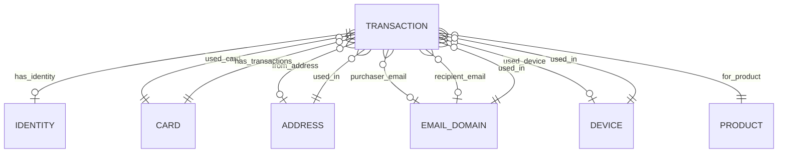
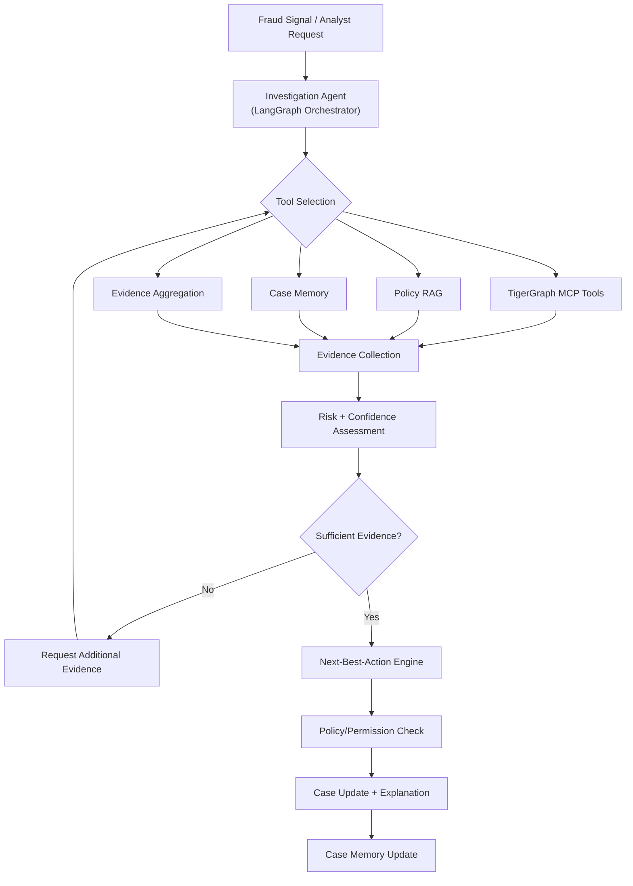

# FraudGraph AI — Project Analysis

> **Phase:** Analysis (pre-implementation)
> **Status:** Awaiting approval before implementation begins
> **Date:** 2026-09-21

---

## 1. Challenge Requirements

### 1.1 Hackathon Context

**Event:** TigerGraph Agentic GraphRAG Hackathon 2026 (hosted on Unstop)

The hackathon requires participants to build an **Agentic GraphRAG** system that autonomously investigates complex multi-step questions by leveraging graph, vector, and document evidence. The system must demonstrate how agentic workflows compare to simpler RAG and GraphRAG approaches.

### 1.2 Core Challenge Requirements

| Requirement | Description |
|---|---|
| **Three-tier comparison** | System must answer questions using RAG, GraphRAG, and Agentic GraphRAG, comparing accuracy, completeness, and token efficiency |
| **Agent Harness** | Manages state, tools, and stopping criteria |
| **Orchestrator Agent** | Decides next action based on the question and gathered evidence |
| **Specialized Agents** | Entity linking, graph traversal, similarity search, evidence evaluation |
| **Autonomous investigation** | Plan → retrieve → evaluate → identify gaps → iterate until comprehensive answer |

### 1.3 Official Judging Criteria

| Criterion | Weight | Description |
|---|---|---|
| **Investigation accuracy** | **25%** | Correctness of fraud identification, entity linking, and graph traversal |
| **Next best action** | **25%** | Quality, safety, and policy compliance of recommended and executed actions |
| **Case summary and explainability** | **10%** | Clarity, completeness, and evidence traceability of agent explanations |
| **Agentic design and engineering** | **15%** | Quality of state management, tool orchestrations, and LangGraph workflow |
| **Innovation** | **15%** | Novel use of GraphRAG, MCP tools, uncertainty handling, and case memory |
| **Demo quality and completeness** | **10%** | Quality of Streamlit UI dashboard, metrics, and demo execution |

### 1.4 Round Structure

| Round | Focus | Deliverables |
|---|---|---|
| **Round 1** | Core challenge | GitHub repo, architecture diagram, demo video, metrics dashboard |
| **Round 2** | Reasoning over time (top 15) | Updated repo, 3–5 min demo, writeup, expanded metrics |

### 1.5 Submission Deadlines

- **Round 1:** September 24, 2026
- **Round 2:** October 1, 2026
- **Results:** October 7, 2026

---

## 2. Dataset Structure

### 2.1 Overview

We are using the **IEEE-CIS Fraud Detection** dataset (originally from a Kaggle competition by Vesta Corporation). This is a real-world e-commerce transaction dataset containing ~590K transactions with identity information.

> [!IMPORTANT]
> The dataset files are **not yet present** in the workspace. You need to download the IEEE-CIS Fraud Detection dataset and place the CSV files in `dataset/HHGOA_IEEE/` before implementation can proceed.

### 2.2 Dataset Files

| File | Description | Estimated Rows | Key |
|---|---|---|---|
| `train_transaction.csv` | Core transaction data | ~590,540 | `TransactionID` |
| `train_identity.csv` | Identity/device data (subset of transactions) | ~144,233 | `TransactionID` |
| `test_transaction.csv` | Test transactions (no labels) | ~506,691 | `TransactionID` |
| `test_identity.csv` | Test identity data | ~141,907 | `TransactionID` |

### 2.3 Transaction Table Schema (`train_transaction.csv`)

| Column(s) | Type | Description |
|---|---|---|
| `TransactionID` | int | Unique transaction identifier (PK) |
| `isFraud` | int (0/1) | Target label — 1 = fraudulent |
| `TransactionDT` | int | Timedelta from a reference datetime (seconds) |
| `TransactionAmt` | float | Transaction amount in USD |
| `ProductCD` | cat | Product code (W, H, C, S, R) |
| `card1` – `card6` | mixed | Card information (issuer, type, category, etc.) — masked |
| `addr1`, `addr2` | float | Address codes (billing region/country) |
| `dist1`, `dist2` | float | Distance measures |
| `P_emaildomain` | cat | Purchaser email domain |
| `R_emaildomain` | cat | Recipient email domain |
| `C1` – `C14` | float | Counting features (e.g., addresses per card) |
| `D1` – `D15` | float | Timedelta features |
| `M1` – `M9` | cat | Match features (T/F/NaN) |
| `V1` – `V339` | float | Vesta-engineered features (masked) |

**Total columns:** ~394

### 2.4 Identity Table Schema (`train_identity.csv`)

| Column(s) | Type | Description |
|---|---|---|
| `TransactionID` | int | Foreign key to transaction table |
| `id_01` – `id_11` | float | Numerical identity features (network info) |
| `id_12` – `id_38` | cat | Categorical identity features (browser, OS, etc.) |
| `DeviceType` | cat | Device type (desktop, mobile) |
| `DeviceInfo` | cat | Device model/browser info |

**Total columns:** ~41

### 2.5 Key Observations About the Data

1. **Join key:** `TransactionID` links transactions to identity records
2. **Not all transactions have identity data** — only ~24% of transactions have a matching identity row
3. **Heavily masked features:** `V1`–`V339`, `id_01`–`id_38`, `C1`–`C14`, `D1`–`D15` have opaque names
4. **Fraud rate:** ~3.5% of transactions are labeled as fraudulent
5. **Email domains** provide network connectivity — shared email domains link transactions
6. **Card features** (`card1`–`card6`) serve as surrogate account/card identifiers
7. **Device and address** information creates linkage opportunities for graph analysis

### 2.6 Actionable Columns for Graph Construction

Not all 434 columns are suitable for graph vertices. The following are the **graph-relevant columns**:

| Column | Graph Role | Rationale |
|---|---|---|
| `TransactionID` | Vertex (Transaction) | Core entity |
| `card1` | Vertex (Card) | Card identifier — links transactions to the same card |
| `card4` | Attribute on Card | Card network (visa, mastercard, etc.) |
| `card6` | Attribute on Card | Card type (debit, credit) |
| `addr1` | Vertex (Address) | Billing region — links transactions to locations |
| `P_emaildomain` | Vertex (EmailDomain) | Purchaser email domain — network linkage |
| `R_emaildomain` | Vertex (EmailDomain) | Recipient email domain |
| `DeviceInfo` | Vertex (Device) | Device model — links transactions using same device |
| `DeviceType` | Attribute on Device | desktop/mobile |
| `ProductCD` | Vertex or Attribute | Product category |
| `TransactionAmt` | Attribute on Transaction | Amount |
| `TransactionDT` | Attribute on Transaction | Timestamp |
| `isFraud` | Attribute on Transaction | Label |
| `id_30` | Attribute (OS) | Operating system |
| `id_31` | Attribute (Browser) | Browser |
| `id_33` | Attribute (Resolution) | Screen resolution |

The `V1`–`V339`, `C1`–`C14`, `D1`–`D15` features are useful as **numerical attributes on vertices** for ML/risk scoring but NOT as graph vertices.

---

## 3. Data Relationships



### Key Linkage Patterns for Fraud Investigation

1. **Card → Transactions:** All transactions on the same card → velocity, amount anomalies
2. **Device → Transactions:** Shared device across different cards → device compromise / fraud ring
3. **Email → Transactions:** Shared email domain → related accounts
4. **Address → Transactions:** Same billing address across cards → synthetic identity
5. **Card ↔ Device:** A card appearing on unusual devices → account takeover
6. **Transaction chains:** Temporal sequences on same card/device → pattern analysis

---

## 4. Proposed TigerGraph Graph Model

### 4.1 Vertex Types

| Vertex Type | Primary Key | Key Attributes |
|---|---|---|
| `Transaction` | `TransactionID` | `amount`, `timestamp`, `product_cd`, `is_fraud`, `C1`–`C14`, `D1`–`D15`, `M1`–`M9` (selected V features as needed) |
| `Card` | `card1` (composite with card4, card6) | `card_network` (card4), `card_type` (card6), `card2`, `card3`, `card5` |
| `EmailDomain` | `domain_name` | `domain_type` (purchaser/recipient/both) |
| `Device` | `device_info` | `device_type` |
| `Address` | `addr1` | `addr2` (country code) |
| `Product` | `product_cd` | — |
| `FraudCase` | `case_id` (generated) | `status`, `risk_score`, `confidence`, `created_at`, `updated_at`, `outcome` |
| `FraudPattern` | `pattern_id` | `name`, `description`, `severity` |

### 4.2 Edge Types

| Edge Type | From → To | Attributes |
|---|---|---|
| `USED_CARD` | Transaction → Card | — |
| `FROM_ADDRESS` | Transaction → Address | — |
| `SENT_FROM_EMAIL` | Transaction → EmailDomain | `role` = "purchaser" |
| `SENT_TO_EMAIL` | Transaction → EmailDomain | `role` = "recipient" |
| `USED_DEVICE` | Transaction → Device | — |
| `FOR_PRODUCT` | Transaction → Product | — |
| `INVESTIGATED_IN` | Transaction → FraudCase | — |
| `MATCHES_PATTERN` | FraudCase → FraudPattern | `confidence` |
| `SAME_CARD` | Transaction → Transaction | Reverse edge for same-card transactions (optional, can be computed) |

### 4.3 Derived / Computed Relationships

These are computed via GSQL queries rather than stored as explicit edges:

- **Shared Device:** Two cards using the same device
- **Shared Email:** Transactions across different cards with same email domain
- **Velocity Anomaly:** N transactions on same card within T seconds
- **Amount Anomaly:** Transaction amount deviates from card's historical average
- **Cross-Address:** Same card used from different addresses

### 4.4 GSQL Installed Queries (Proposed)

| Query | Purpose |
|---|---|
| `get_transaction_details` | Retrieve full transaction with all connected entities |
| `get_card_history` | All transactions for a card, ordered by time |
| `find_shared_devices` | Cards/transactions sharing the same device |
| `find_shared_emails` | Transactions linked by email domain |
| `find_connected_entities` | N-hop traversal from a transaction |
| `compute_card_velocity` | Transaction count/amount within time windows |
| `detect_amount_anomaly` | Flag transactions outside card's normal range |
| `find_cross_address_usage` | Same card from different addresses |
| `find_fraud_ring` | Connected component analysis for fraud rings |
| `get_fraud_rate_by_entity` | Fraud rate for a card/device/email/address |

---

## 5. Agent Architecture

### 5.1 High-Level Design



### 5.2 LangGraph State Model

```python
class InvestigationState(TypedDict):
    # Case identification
    case_id: str
    trigger: dict                       # What initiated the investigation
    status: str                         # open, investigating, pending_evidence, resolved

    # Target entities
    target_transaction_id: Optional[int]
    target_card: Optional[str]

    # Evidence collected
    transaction_details: Optional[dict]
    card_history: list[dict]
    connected_entities: list[dict]
    shared_devices: list[dict]
    shared_emails: list[dict]
    device_info: Optional[dict]
    address_info: Optional[dict]

    # Analysis results
    graph_findings: list[dict]          # Structured findings from graph traversal
    fraud_patterns: list[dict]          # Matched fraud patterns
    historical_cases: list[dict]        # Similar previous cases
    policy_findings: list[dict]         # Relevant policies

    # Risk assessment
    risk_score: float                   # 0.0 – 1.0
    risk_factors: list[dict]            # Contributing factors with weights
    confidence: float                   # 0.0 – 1.0
    uncertainty_factors: list[str]      # What we don't know

    # Evidence gaps
    missing_evidence: list[str]         # What evidence is still needed
    requested_evidence: list[dict]      # Evidence requests made
    received_evidence: list[dict]       # Evidence received after requests

    # Decision
    recommended_action: Optional[dict]  # The NBA recommendation
    approval_required: bool
    approval_authority: Optional[str]
    action_executed: Optional[dict]

    # Explanation
    reasoning_summary: str
    evidence_chain: list[dict]          # Ordered evidence supporting the decision

    # Timeline
    investigation_timeline: list[dict]  # Timestamped events
    iteration_count: int                # Number of investigation loops

    # Messages (LangGraph)
    messages: list                      # LLM conversation messages
```

### 5.3 LangGraph Node Design

| Node | Responsibility |
|---|---|
| `trigger_handler` | Parse the incoming fraud signal, create initial state |
| `evidence_gatherer` | Call TigerGraph MCP tools to collect transaction/entity data |
| `graph_investigator` | Run graph traversal queries (shared devices, fraud rings, velocity) |
| `pattern_matcher` | Compare findings against known fraud patterns |
| `historical_case_retriever` | Search case memory for similar past investigations |
| `policy_retriever` | Retrieve relevant fraud policies via RAG |
| `risk_assessor` | Compute risk score and confidence from all evidence |
| `sufficiency_evaluator` | Decide if evidence is sufficient or more is needed |
| `evidence_requester` | Generate controlled additional evidence requests |
| `action_recommender` | Determine the next-best-action based on evidence |
| `policy_evaluator` | Check if action is permitted, requires approval, or needs escalation |
| `case_updater` | Update case record, generate explanation |
| `memory_writer` | Write final case to case memory for future retrieval |

### 5.4 Investigation Flow (LangGraph Edges)

```
trigger_handler
    → evidence_gatherer
    → graph_investigator
    → pattern_matcher
    → historical_case_retriever
    → policy_retriever
    → risk_assessor
    → sufficiency_evaluator
    → [CONDITIONAL]
        IF insufficient → evidence_requester → evidence_gatherer (loop)
        IF sufficient → action_recommender
    → policy_evaluator
    → case_updater
    → memory_writer
    → END
```

---

## 6. Tool Architecture

### 6.1 TigerGraph MCP Tools (via `tigergraph-mcp`)

These are the built-in tools provided by the TigerGraph MCP server:

| Tool | Purpose |
|---|---|
| `tigergraph__run_query` | Execute installed GSQL queries |
| `tigergraph__get_neighbors` | Traverse graph from a vertex |
| `tigergraph__get_graph_schema` | Introspect schema |
| `tigergraph__vector_search` | ANN search on embeddings |
| `tigergraph__generate_gsql` | LLM-generated GSQL queries (optional) |

### 6.2 Custom Investigation Tools (Python functions exposed to LangGraph)

| Tool | Input | Output | Source |
|---|---|---|---|
| `get_transaction` | `transaction_id` | Full transaction details with connected entities | GSQL via MCP |
| `get_card_history` | `card_id`, `time_window` | List of transactions on the card | GSQL via MCP |
| `find_shared_devices` | `card_id` or `transaction_id` | Other cards/transactions using same device | GSQL via MCP |
| `find_shared_emails` | `email_domain` | Transactions sharing email domain | GSQL via MCP |
| `find_connected_entities` | `entity_id`, `hops` | N-hop subgraph | GSQL via MCP |
| `compute_velocity` | `card_id`, `window_seconds` | Transaction count and total amount | GSQL via MCP |
| `detect_amount_anomaly` | `transaction_id` | Whether amount is anomalous for this card | GSQL + Python |
| `find_fraud_ring` | `starting_entity` | Connected component of potentially linked fraud | GSQL via MCP |
| `get_entity_fraud_rate` | `entity_type`, `entity_id` | Historical fraud rate for the entity | GSQL via MCP |
| `retrieve_policy` | `policy_type` or `query` | Relevant fraud policies | RAG |
| `retrieve_similar_cases` | `case_summary` or `features` | Similar historical cases | Vector search + case memory |
| `create_case` | `trigger`, `target` | New case record | Python |
| `update_case` | `case_id`, `updates` | Updated case record | Python |
| `record_evidence` | `case_id`, `evidence` | Evidence logged to case | Python |
| `recommend_action` | `case_id`, `action`, `reasoning` | Action recommendation | Python |

---

## 7. GraphRAG Architecture

### 7.1 What Gets Embedded

| Content Type | Storage | Retrieval Method |
|---|---|---|
| **Graph subgraphs** (serialized context around an entity) | TigerGraph Vector DB or ChromaDB | Vector similarity |
| **Fraud policies** (synthetic documents based on patterns) | ChromaDB | Semantic search |
| **Fraud pattern descriptions** | ChromaDB | Semantic search |
| **Historical case summaries** | ChromaDB | Semantic search |

### 7.2 Retrieval Flow

```
Agent Question
    → Query Decomposition
    → [Parallel]
        ├── Graph Traversal (TigerGraph GSQL) → Structured Evidence
        ├── Policy Search (ChromaDB) → Policy Context
        ├── Pattern Search (ChromaDB) → Pattern Context
        └── Case Memory Search (ChromaDB) → Historical Context
    → Context Assembly
    → LLM Reasoning (with all evidence)
```

### 7.3 Context Assembly Strategy

Rather than dumping everything into the prompt:

1. **Structured evidence** from graph queries → formatted as tables/lists
2. **Policy context** → top-K relevant policies
3. **Pattern context** → matched patterns with descriptions
4. **Historical cases** → top-K similar cases with outcomes
5. **Evidence summary** → token-efficient summary of all collected data

---

## 8. Case Memory Architecture

### 8.1 Storage Format

Each closed case is stored as a structured JSON document:

```json
{
  "case_id": "CASE-2026-00001",
  "trigger": { "type": "suspicious_transaction", "transaction_id": 12345 },
  "entities_involved": ["card:1234", "device:Samsung", "email:gmail.com"],
  "evidence_summary": "...",
  "fraud_patterns_matched": ["velocity_spike", "device_sharing"],
  "risk_score": 0.87,
  "confidence": 0.92,
  "recommended_action": "block_card",
  "approval_required": true,
  "outcome": "confirmed_fraud",
  "reasoning": "...",
  "timestamp": "2026-09-21T08:00:00Z"
}
```

### 8.2 Retrieval Strategy

1. **Vector embedding** of case summary → store in ChromaDB
2. **Metadata filtering** → filter by entity type, fraud pattern, outcome
3. **Top-K retrieval** → return most similar past cases
4. **Entity-based lookup** → find cases involving the same card/device/email

### 8.3 Memory-Informed Investigation

When investigating a new case:
- Search for cases involving the same entities (card, device, email domain)
- Search for cases with similar patterns (velocity, amount, cross-device)
- Use outcomes of past cases to inform risk assessment
- Never copy/paste past decisions — use as contextual evidence

---

## 9. Policy Architecture

### 9.1 Policy Document Structure

Since the IEEE-CIS dataset does not include explicit policy documents, we will create a **realistic fraud policy framework** based on standard financial fraud investigation practices:

| Policy Area | Examples |
|---|---|
| **Transaction Thresholds** | High-value transaction review (\$5000+), micro-transaction flooding |
| **Velocity Rules** | >N transactions in T minutes triggers review |
| **Device Rules** | New device on existing card, multiple cards on one device |
| **Geographic Rules** | Cross-country transactions, impossible travel |
| **Pattern Rules** | Card testing (small→large), round-amount fraud |
| **Action Policies** | When to block vs. monitor, escalation thresholds |
| **Approval Matrix** | Which actions require analyst approval |

### 9.2 Deterministic Policy Engine

```python
class PolicyDecision:
    action_allowed: bool
    approval_required: bool
    approval_authority: str  # "auto", "analyst", "manager", "compliance"
    escalation_required: bool
    reason: str
```

The policy engine is **not an LLM** — it is a deterministic rules engine:

1. LLM recommends an action
2. Policy engine evaluates:
   - Is this action type valid?
   - Is the risk score high enough to justify this action?
   - Does this action require approval at this risk level?
   - Is there a regulatory requirement?
3. Returns a structured decision

---

## 10. UI Architecture

### 10.1 Streamlit Dashboard Layout

```
┌─────────────────────────────────────────────────────┐
│  FraudGraph AI — Analyst Dashboard                  │
├──────────────┬──────────────────────────────────────┤
│              │                                      │
│  Case List   │   Case Detail View                   │
│  - Active    │   ┌──────────────────────────────┐   │
│  - Resolved  │   │ Case Overview                │   │
│  - Pending   │   │ Risk: 87% | Confidence: 92%  │   │
│              │   └──────────────────────────────┘   │
│  [New Case]  │                                      │
│              │   ┌──────────────────────────────┐   │
│  Filters:    │   │ Transaction Details           │   │
│  - Status    │   │ Amount, Time, Product, Card   │   │
│  - Risk      │   └──────────────────────────────┘   │
│  - Date      │                                      │
│              │   ┌──────────────────────────────┐   │
│              │   │ Graph Visualization           │   │
│              │   │ (Interactive network)         │   │
│              │   └──────────────────────────────┘   │
│              │                                      │
│              │   ┌──────────────┬───────────────┐   │
│              │   │ Evidence     │ Patterns      │   │
│              │   │ - Graph      │ - Velocity    │   │
│              │   │ - Device     │ - Device share│   │
│              │   │ - Email      │ - Amount      │   │
│              │   └──────────────┴───────────────┘   │
│              │                                      │
│              │   ┌──────────────────────────────┐   │
│              │   │ Investigation Timeline        │   │
│              │   │ ● Evidence gathered            │   │
│              │   │ ● Risk assessed                │   │
│              │   │ ● Action recommended           │   │
│              │   └──────────────────────────────┘   │
│              │                                      │
│              │   ┌──────────────────────────────┐   │
│              │   │ Next-Best-Action              │   │
│              │   │ Recommendation: Block Card    │   │
│              │   │ Approval: Analyst Required    │   │
│              │   │ [Approve] [Reject] [Escalate] │   │
│              │   └──────────────────────────────┘   │
│              │                                      │
│              │   ┌──────────────────────────────┐   │
│              │   │ Agent Explanation             │   │
│              │   │ Full reasoning trace          │   │
│              │   └──────────────────────────────┘   │
├──────────────┴──────────────────────────────────────┤
│  Metrics Dashboard | Token Usage | Investigation Log │
└─────────────────────────────────────────────────────┘
```

### 10.2 Key UI Components

1. **Case List Sidebar** — filterable list of all cases
2. **Case Overview Card** — risk score, confidence, status badges
3. **Transaction Detail Panel** — all transaction attributes
4. **Graph Visualization** — interactive network using `plotly` or `pyvis`
5. **Evidence Panel** — categorized evidence items
6. **Pattern Panel** — matched fraud patterns with severity
7. **Historical Case Matches** — similar past cases
8. **Policy Findings** — applicable policies
9. **Investigation Timeline** — chronological event log
10. **Uncertainty Panel** — missing evidence, open questions
11. **NBA Panel** — recommended action with approve/reject/escalate buttons
12. **Agent Explanation** — full reasoning trace in markdown
13. **Metrics Dashboard** — accuracy, token usage, investigation statistics

---

## 11. Evaluation Architecture

### 11.1 Benchmark Pipeline

Since the challenge mentions 20 benchmark cases (from your project spec), we will:

1. **Select 20 diverse cases** from the dataset:
   - 10 confirmed fraud cases (`isFraud=1`)
   - 10 legitimate cases (`isFraud=0`)
   - Covering different fraud patterns, amounts, and entity types
2. **Run each through the full investigation pipeline**
3. **Record comprehensive metrics**

### 11.2 Evaluation Metrics

| Metric | What It Measures |
|---|---|
| **Investigation Accuracy** | Did the agent correctly identify fraud/non-fraud? |
| **Evidence Completeness** | How many relevant graph relationships were found? |
| **Action Appropriateness** | Was the recommended action reasonable for the evidence? |
| **Confidence Calibration** | Is confidence correlated with actual correctness? |
| **Token Efficiency** | Total tokens used per investigation |
| **Tool Call Count** | Number of tool calls per investigation |
| **Investigation Time** | Wall-clock time per investigation |
| **Evidence Trail** | Is every recommendation traceable to retrieved evidence? |

### 11.3 Three-Tier Comparison

For each benchmark case, run:

1. **RAG only:** Embed transaction features → retrieve similar → LLM decides
2. **GraphRAG:** Graph traversal + embedding retrieval → LLM decides
3. **Agentic GraphRAG:** Full investigation agent with iterative evidence gathering

Compare accuracy, completeness, and token usage across all three.

### 11.4 Output Format

Each benchmark run produces:

```json
{
  "case_id": "BENCH-001",
  "transaction_id": 12345,
  "ground_truth": "fraud",
  "rag_result": { "prediction": "fraud", "confidence": 0.7, "tokens": 1200 },
  "graphrag_result": { "prediction": "fraud", "confidence": 0.85, "tokens": 2400 },
  "agentic_result": {
    "prediction": "fraud",
    "confidence": 0.95,
    "tokens": 5600,
    "tool_calls": 8,
    "evidence_items": 12,
    "action": "block_card",
    "approval_required": true,
    "investigation_time_seconds": 45
  }
}
```

---

## 12. Risks and Unknowns

### 12.1 Risks

| Risk | Severity | Mitigation |
|---|---|---|
| **Dataset not yet in workspace** | 🔴 Critical | User must download and place IEEE-CIS files before Phase 2 |
| **Large dataset size** (~590K rows) | 🟡 Medium | Load subset for development, full dataset for benchmarks |
| **Masked columns** (V1–V339) | 🟡 Medium | Focus graph on interpretable columns; use V features only for risk scoring |
| **TigerGraph resource limits** (if using Savanna free tier) | 🟡 Medium | Design efficient GSQL queries; partition data if needed |
| **No explicit challenge PDF** available | 🟡 Medium | Working from web-scraped challenge requirements |
| **LLM cost / token budget** | 🟡 Medium | Efficient prompts; cache evidence; minimize redundant calls |
| **Time pressure** (deadline Sep 24) | 🔴 Critical | Prioritize core investigation flow over polish |

### 12.2 Unknowns

1. **Exact hackathon dataset variant:** The challenge may provide a modified version of IEEE-CIS (the "HHGOA" reference). We should confirm with the organizer whether it's the standard Kaggle dataset or a custom variant.
2. **Benchmark case format:** Whether the 20 benchmark cases are pre-selected by the organizers or self-selected.
3. **TigerGraph Savanna vs. Docker:** Whether the hackathon requires using TigerGraph Savanna (cloud) or allows self-hosted Docker.
4. **MCP server version compatibility:** Need to verify `tigergraph-mcp` version against our TigerGraph version.

---

## 13. Implementation Phases

### Phase 1: Analysis ✅ (this document)
- [x] Challenge requirements analysis
- [x] Dataset structure analysis
- [x] Graph model design
- [x] Agent architecture design
- [x] Tool inventory
- [x] Implementation roadmap

### Phase 2: Project Setup
- [ ] Download and verify dataset files
- [ ] Set up Python virtual environment
- [ ] Install dependencies
- [ ] Set up TigerGraph (Docker or Savanna)
- [ ] Configure `.env`
- [ ] Verify TigerGraph MCP connection

### Phase 3: Data Pipeline
- [ ] Load and profile CSV files
- [ ] Clean and validate data
- [ ] Generate graph-ready data (vertices and edges CSVs)
- [ ] Create TigerGraph loading jobs
- [ ] Load data into TigerGraph
- [ ] Verify graph statistics

### Phase 4: TigerGraph Schema + Queries
- [ ] Create GSQL schema (vertices + edges)
- [ ] Write and install GSQL queries
- [ ] Test each query independently
- [ ] Verify query performance

### Phase 5: MCP Tools
- [ ] Set up TigerGraph MCP server
- [ ] Create custom investigation tools
- [ ] Test each tool independently
- [ ] Verify MCP ↔ LangGraph integration

### Phase 6: Investigation Agent (Core)
- [ ] Define LangGraph state model
- [ ] Implement LangGraph nodes
- [ ] Wire investigation flow
- [ ] Test with single transaction
- [ ] Verify iterative evidence loop

### Phase 7: GraphRAG + Policy
- [ ] Create fraud policy documents
- [ ] Set up ChromaDB for policy/pattern/case embedding
- [ ] Implement RAG retrieval tools
- [ ] Implement deterministic policy engine
- [ ] Test policy evaluation

### Phase 8: Case Memory
- [ ] Implement case storage (JSON + ChromaDB)
- [ ] Implement case retrieval (vector + metadata)
- [ ] Implement memory-informed investigation
- [ ] Test with synthetic past cases

### Phase 9: Next-Best-Action
- [ ] Implement action recommendation logic
- [ ] Implement approval matrix
- [ ] Wire into investigation flow
- [ ] Test action recommendations

### Phase 10: UI
- [ ] Streamlit app skeleton
- [ ] Case list + filters
- [ ] Case detail view
- [ ] Graph visualization
- [ ] Evidence + pattern panels
- [ ] Investigation timeline
- [ ] NBA + approval panel
- [ ] Agent explanation panel

### Phase 11: Benchmark
- [ ] Select 20 benchmark cases
- [ ] Implement three-tier comparison pipeline
- [ ] Run benchmarks
- [ ] Generate metrics dashboard
- [ ] Produce comparison report

### Phase 12: Testing
- [ ] Unit tests for data pipeline
- [ ] Unit tests for GSQL queries
- [ ] Unit tests for policy engine
- [ ] Integration tests
- [ ] End-to-end investigation test

### Phase 13: Documentation + Demo
- [ ] Architecture documentation
- [ ] Demo video preparation
- [ ] README finalization
- [ ] Submission package

---

## Appendix A: Technology Stack Summary

| Component | Technology | Purpose |
|---|---|---|
| Graph Database | TigerGraph (Docker or Savanna) | Entity storage, relationship traversal, fraud pattern detection |
| Graph Query | GSQL | Graph analytics, installed queries |
| Agent Framework | LangGraph | Stateful investigation orchestration |
| LLM | OpenAI GPT-4o (or compatible) | Reasoning, synthesis, explanation |
| MCP | `tigergraph-mcp` | Agent ↔ TigerGraph integration |
| Vector Store | ChromaDB | Policy/pattern/case embedding retrieval |
| Embedding | `text-embedding-3-small` | Document/case embedding |
| API | FastAPI | Backend API for UI |
| UI | Streamlit | Analyst dashboard |
| Data Processing | Pandas, NumPy | CSV loading, profiling, transformation |
| Testing | pytest | Unit and integration tests |
| Visualization | Plotly, PyVis | Graph and chart visualization |
| Containerization | Docker, Docker Compose | TigerGraph, API, UI deployment |

## Appendix B: File Locations

| Path | Purpose |
|---|---|
| `dataset/HHGOA_IEEE/` | Raw dataset CSV files (to be added) |
| `src/agent/` | LangGraph investigation agent |
| `src/graph/` | TigerGraph schema, queries, loader |
| `src/tools/` | MCP tools and custom investigation tools |
| `src/rag/` | GraphRAG retrieval, embedding, policy search |
| `src/memory/` | Case memory storage and retrieval |
| `src/policy/` | Policy documents and deterministic policy engine |
| `src/analysis/` | Risk scoring, pattern matching, analytics |
| `src/api/` | FastAPI endpoints |
| `ui/` | Streamlit dashboard |
| `scripts/` | Data loading, setup, utility scripts |
| `tests/` | Test suite |
| `outputs/` | Benchmark results, investigation records |
| `docs/` | Documentation |
